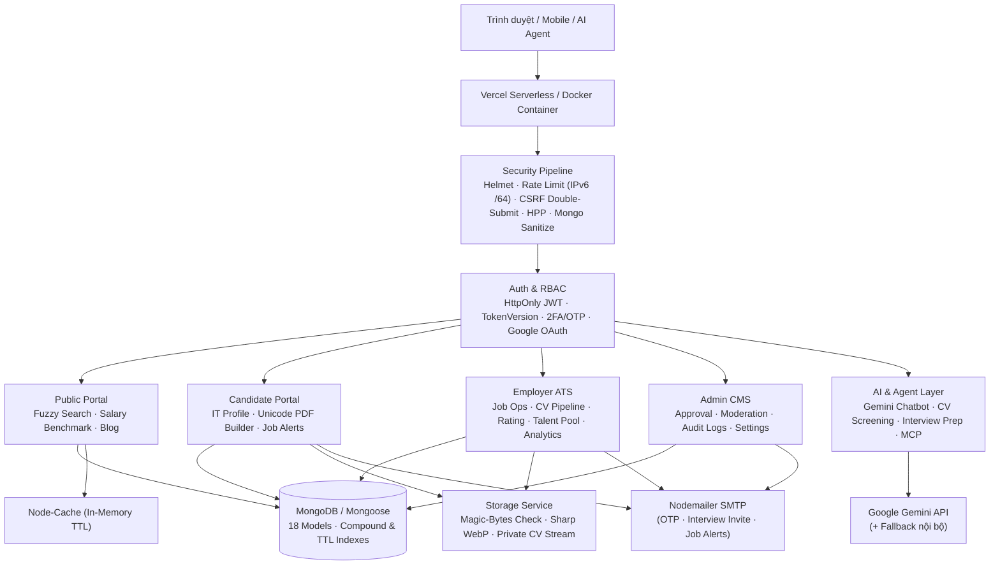

# VN.ITJobs — Nền Tảng Tuyển Dụng IT, ATS & Cổng Quản Trị Chuyên Biệt

[](https://tuyen-dung-it.vercel.app/)
[](https://nodejs.org/)
[](https://expressjs.com/)
[](https://tailwindcss.com/)
[](https://mongoosejs.com/)
[](./Dockerfile)
[-16a34a)](#6-kiểm-thử-tự-động--hiệu-năng)
[](#5-các-lệnh-thực-thi-hệ-thống)
[](LICENSE)

> **Live Demo:** [https://tuyen-dung-it.vercel.app/](https://tuyen-dung-it.vercel.app/) · **API Spec:** `/openapi.json` · **Agent Context:** `/llms.txt`

**VN.ITJobs** là nền tảng tuyển dụng công nghệ thông tin full-stack kết hợp hệ thống quản trị ứng viên (**ATS**) và trợ lý **AI (Google Gemini)**, được thiết kế theo kiến trúc **Server-Side Rendering (SSR)** với **Express.js**, **Pug**, **Tailwind CSS v4** và **MongoDB/Mongoose**. Hệ thống bao phủ trọn vẹn 4 phân hệ: **Cổng công khai (Public)**, **Ứng viên (Candidate)**, **Nhà tuyển dụng (Employer ATS)** và **Quản trị viên (Admin CMS)** — chú trọng thực chiến vào **Bảo mật đa tầng**, **Hiệu năng truy vấn (Zero COLLSCAN)** và **Khả năng vận hành Production (Docker + CI/CD)**.

---

## 1. Kiến Trúc Hệ Thống



---

## 2. Tính Năng Nổi Bật Theo Phân Hệ

| Phân hệ | Tính năng cốt lõi |
| :--- | :--- |
| **Công khai (Public)** | Tìm kiếm việc làm đa chiều (thành phố, cấp bậc, hình thức, kỹ năng, tìm kiếm tiếng Việt không dấu/fuzzy), trang chi tiết công ty & đánh giá, **Salary Benchmark** (thống kê dải lương IT), **Blog công nghệ**, SEO chuẩn (`sitemap.xml`, `robots.txt`, OpenGraph), và giao diện tương thích AI Agent (`/openapi.json`, `/llms.txt`, MCP endpoint). |
| **Ứng viên (Candidate)** | Đăng ký xác thực OTP / **Google OAuth 2.0**, quản lý hồ sơ IT, **tạo & xuất CV PDF hỗ trợ Unicode tiếng Việt** (`pdfkit`), nộp CV PDF riêng tư, theo dõi trạng thái & rút hồ sơ, lưu việc làm, theo dõi công ty, đăng ký **Job Alert** theo tần suất (`instant`/`daily`/`weekly`). |
| **Nhà tuyển dụng (Employer ATS)** | Quy trình duyệt tài khoản trước khi đăng tin, quản lý tin tuyển dụng, **ATS xem xét CV** (xem PDF inline an toàn, chấm điểm/rating, ghi chú, chuyển trạng thái pipeline), **đặt lịch & gửi thư mời phỏng vấn**, phân quyền đội ngũ (**Team RBAC**), **Talent Pool** và thống kê hiệu quả tuyển dụng (**Analytics**). |
| **Quản trị (Admin CMS)** | Cổng tách biệt hoàn toàn (`ADMIN_PATH`, cookie `itj_admin_token` và `ADMIN_JWT_SECRET` riêng), bảo vệ **2FA/OTP**, phê duyệt/khóa NTD, kiểm duyệt tin & đánh giá, quản lý bài viết Blog, phản hồi người dùng, cấu hình hệ thống động và **Audit Logs** tự động hết hạn sau 365 ngày (TTL Index). |
| **AI Assistant (Gemini)** | Trợ lý chat hỗ trợ có tool-calling, **sàng lọc & chấm điểm CV** (trích xuất văn bản bằng `pdf-parse` + fallback OCR đa phương thức), gợi ý **luyện phỏng vấn** theo JD — có cơ chế fallback an toàn khi thiếu API key hoặc mất kết nối. |

---

## 3. Điểm Nhấn Kỹ Thuật & Bảo Mật (Engineering Highlights)

- **Xác thực & Thu hồi phiên tức thời:** JWT lưu trong cookie `HttpOnly`, tách độc lập cookie User (`itj_token`) và Admin (`itj_admin_token`). Cơ chế **`tokenVersion`** giúp vô hiệu hóa toàn bộ phiên đăng nhập ngay lập tức khi đổi mật khẩu hoặc bị khóa tài khoản mà không cần thêm hạ tầng session phức tạp.
- **Phòng thủ đa tầng (Defense-in-Depth):**
  - Chống CSRF chuẩn hiện đại bằng **`csrf-csrf` (Double Submit Cookie)** tương thích cả form thường lẫn `multipart/form-data`.
  - **Rate Limiting đa lớp** (`express-rate-limit`): gom nhóm IPv6 `/64` chống xoay IP, kết hợp giới hạn theo cặp `IP + Email` chống Credential Stuffing & OTP Bombing.
  - **Kiểm tra Magic Bytes nhị phân khi Upload:** Không tin tưởng `Content-Type` hay đuôi file; kiểm tra chữ ký nhị phân (JPEG/PNG/WebP/`%PDF-` + `%%EOF`), chặn PDF polyglot/JS độc hại, xử lý lại ảnh qua `sharp` sang **WebP**, và lưu CV ở thư mục riêng tư `storage/private/cv/` chỉ stream khi xác thực đúng quyền sở hữu.
  - Chống XSS (`sanitize-html`), NoSQL Injection (`express-mongo-sanitize`), HTTP Parameter Pollution (`hpp`), và cấu hình HTTP security headers (`helmet`, `X-Robots-Tag: noindex, nofollow` cho trang Admin).
- **Tối ưu Database (Zero COLLSCAN & Zero N+1):** Thiết kế Compound Index theo quy tắc **ESR (Equality → Sort → Range)**, Multikey Index cho kỹ năng, TTL Index cho Audit Log/OTP, và dùng MongoDB Aggregation (`$group`) khử hoàn toàn N+1 query ở các trang danh sách.
- **Production-Ready DevOps:** `Dockerfile` multi-stage 3 tầng (non-root user `node`, `HEALTHCHECK` dùng `fetch` nội bộ, exec-form PID 1 nhận `SIGTERM` graceful shutdown) kèm GitHub Actions CI chạy matrix Node 20/22 + container smoke test.

---

## 4. Hướng Dẫn Cài Đặt & Khởi Chạy

### Cách 1: Chạy nhanh bằng Docker Compose (Khuyến nghị)
Chỉ cần cài [Docker Desktop](https://www.docker.com/products/docker-desktop/), toàn bộ ứng dụng và MongoDB 7.0 sẽ tự động build, kết nối và chạy healthcheck:

```bash
docker compose up --build -d
```
Truy cập ứng dụng tại `http://localhost:3000` (cổng quản trị: `http://localhost:3000/admin`).

### Cách 2: Chạy Local (Node.js ≥ 18)

1. **Cài đặt thư viện & cấu hình môi trường:**
   ```bash
   npm install
   cp .env.example .env
   ```
   *(Nếu chưa cài MongoDB cục bộ, ứng dụng sẽ tự động kích hoạt **MongoDB In-Memory** để chạy thử ngay lập tức).*

2. **Biên dịch CSS (Tailwind CSS v4) & nạp dữ liệu mẫu:**
   ```bash
   npm run build:css
   npm run seed          # Dữ liệu chuẩn tiếng Việt
   # Hoặc: npm run seed -- --big   (10.000 việc làm, 500 công ty, 2.000 ứng viên)
   ```

3. **Khởi động server:**
   ```bash
   npm run dev           # Môi trường phát triển (nodemon)
   # Hoặc: npm start     # Môi trường production
   ```

### Tài Khoản Dùng Thử Mẫu (Sau khi chạy `npm run seed`)

| Vai trò | Email đăng nhập | Mật khẩu | Mô tả |
| :--- | :--- | :--- | :--- |
| **Superadmin** | `superadmin@admin.vn` | `AdminPass123` | Quản trị toàn hệ thống, duyệt NTD, Audit Logs, CMS |
| **Nhà tuyển dụng (Active)** | `lgcns@gmail.com` | `Password123` | Đăng tin, ATS duyệt CV, đặt lịch phỏng vấn, Analytics |
| **Nhà tuyển dụng (Pending)** | `contact@nexttech.vn` | `Password123` | Tài khoản chờ duyệt (bị chặn đăng tin mới) |
| **Ứng viên** | `levana@gmail.com` | `Password123` | Hồ sơ IT, xuất CV PDF, nộp đơn, lưu việc & Job Alert |

---

## 5. Các Lệnh Thực Thi Hệ Thống

| Câu lệnh | Mô tả tác vụ |
| :--- | :--- |
| `npm run dev` | Chạy server phát triển với `nodemon` tại cổng `3000` |
| `npm start` | Khởi động server chế độ production |
| `npm run build:css` | Biên dịch & nén Tailwind CSS v4 ra `public/assets/css/tailwind.css` |
| `npm run seed` | Nạp dữ liệu mẫu tiêu chuẩn tiếng Việt |
| `npm run seed -- --big` | Nạp bộ dữ liệu thử tải lớn (10.000 việc làm) |
| `npm run benchmark` | Đo hiệu năng truy vấn với `explain("executionStats")` (Zero COLLSCAN) |
| `npm run create-admin` | Tạo tài khoản Superadmin qua CLI tương tác |
| `npm test` | Chạy toàn bộ **25 test suites / 326 test cases** (Jest + Supertest) |
| `npm run lint` | Kiểm tra chất lượng mã nguồn với ESLint (0 errors) |
| `npm run format` | Định dạng mã nguồn tự động với Prettier |

---

## 6. Kiểm Thử Tự Động & Hiệu Năng

- **Automated Testing:** **326/326 test cases vượt qua (100%) trên 25 test suites** — bao phủ unit, integration, phân quyền RBAC, phiên đăng nhập đồng thời, bảo mật red-team (`tests/redteam_security.test.js`, `tests/security_audit.test.js`), và hồi quy QA 4 phân hệ.
- **Database Benchmark (10.000 việc làm):** Các truy vấn lọc đa chiều, quản lý tin NTD và quản lý CV ứng viên đều đạt **`IXSCAN` 100% (ZERO COLLSCAN)** với độ trễ **1–5 ms** (chi tiết trong [`docs/PERFORMANCE.md`](./docs/PERFORMANCE.md)).
- **CI/CD Pipeline:** Tự động chạy ESLint, build CSS, toàn bộ Jest suites trên **Node 20.x & 22.x**, build Docker image, kiểm tra `/healthz` + `/health` và xác minh container thoát sạch mã `0` khi nhận tín hiệu `SIGTERM` ([`.github/workflows/ci.yml`](./.github/workflows/ci.yml)).

---

## 7. Cấu Trúc Thư Mục & Tài Liệu Kỹ Thuật

```text
vn-itjobs/
├── .github/workflows/ci.yml   # CI Pipeline (Test matrix + Docker SIGTERM smoke test)
├── docs/
│   ├── SPECIFICATIONS.md      # Đặc tả nghiệp vụ & phân hệ
│   ├── DECISIONS.md           # Architectural Decision Records (ADR)
│   └── PERFORMANCE.md         # Báo cáo benchmark 10.000 bản ghi & Index Matrix
├── api/index.js               # Entrypoint triển khai Vercel Serverless
├── public/                    # Static assets, OpenAPI 3.1 spec, llms.txt
├── src/
│   ├── app.js & server.js     # Express app, middlewares & graceful shutdown
│   ├── config/                # ENV validation, DB connection, Constants
│   ├── controllers/           # 29 controllers (client, candidate, employer, admin, ai, mcp)
│   ├── middlewares/           # Auth, CSRF, Upload, RateLimit, Locals, Flash
│   ├── models/                # 18 Mongoose models & Compound/TTL indexes
│   ├── routes/                # 5 bộ router phân hệ
│   ├── services/              # 15 services (AI, PDF, Storage, FuzzySearch, Mail, Audit...)
│   └── scripts/               # Seed, Benchmark, Create-admin, Export SQL
├── tests/                     # 25 test suites (326 test cases)
├── views/                     # Pug SSR layouts, pages, admin, partials & mixins
├── Dockerfile                 # Multi-stage production container (non-root)
└── docker-compose.yml         # Orchestration App + MongoDB 7.0
```
